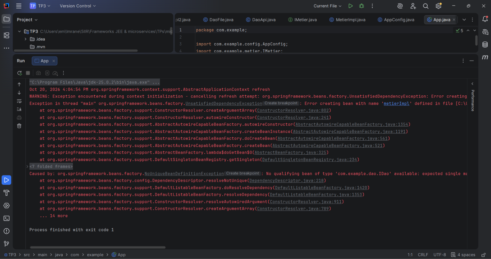
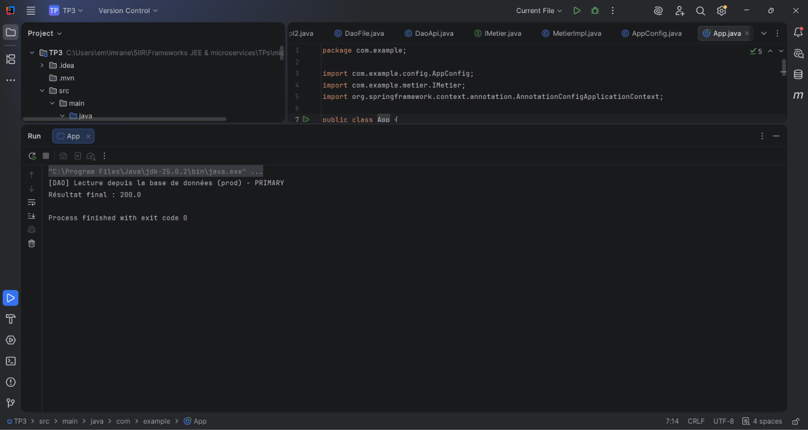
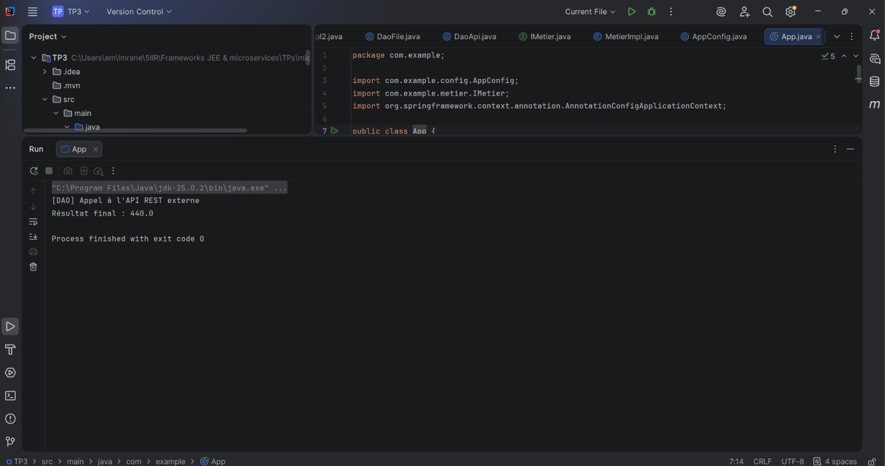
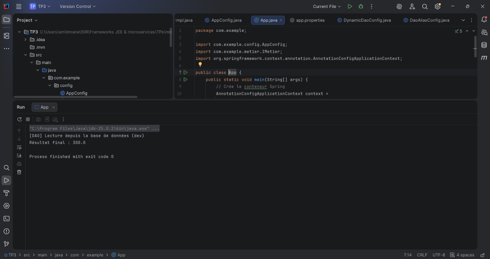
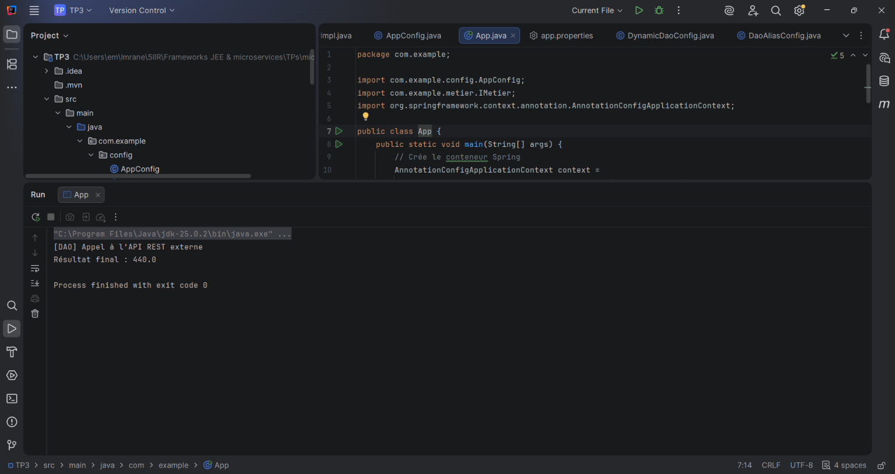
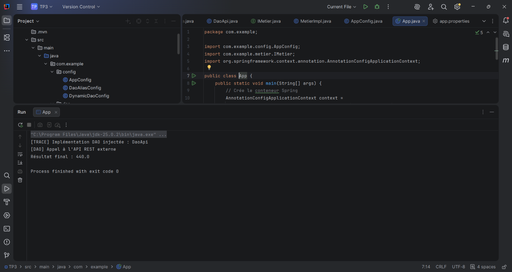
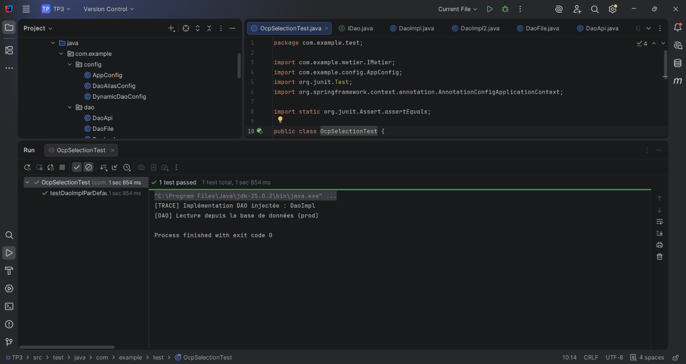
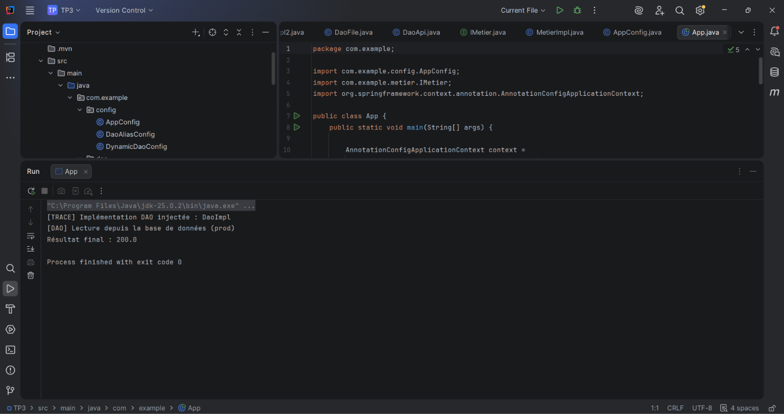
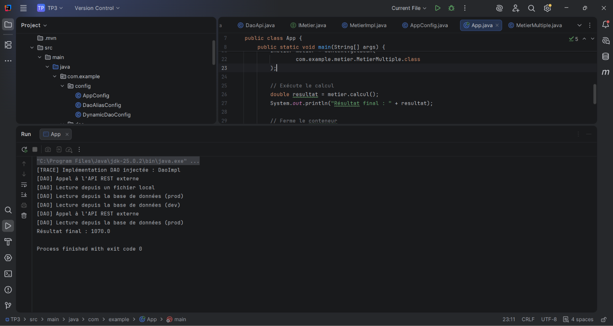
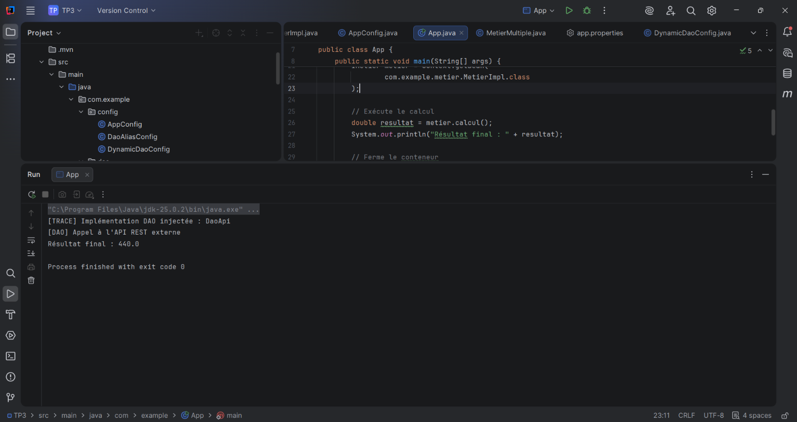

# TP3 — Spring IoC & OCP : Stratégies d'Injection et Sélection d'Implémentations

**Module :** Architecture Microservices : Conception, Déploiement et Orchestration

## 1. Introduction

Ce TP a pour objectif de comprendre les mécanismes d'injection de dépendances avec Spring Framework et d'appliquer le principe Ouvert/Fermé (OCP).

Nous avons mis en place plusieurs implémentations d'une interface DAO et expérimenté différentes stratégies permettant de sélectionner une source de données sans modifier la logique métier.

## 2. Technologies utilisées

- Java (JDK 25)
- Spring Framework (`spring-context`)
- Maven
- IntelliJ IDEA
- JUnit 4
- API d'injection de dépendances Spring

## 3. Structure du projet

```text
TP3/
├── src/
│   ├── main/
│   │   ├── java/com/example/
│   │   │   ├── config/
│   │   │   │   ├── AppConfig.java
│   │   │   │   ├── DaoAliasConfig.java
│   │   │   │   └── DynamicDaoConfig.java
│   │   │   ├── dao/
│   │   │   │   ├── IDao.java
│   │   │   │   ├── DaoImpl.java
│   │   │   │   ├── DaoImpl2.java
│   │   │   │   ├── DaoFile.java
│   │   │   │   ├── DaoApi.java
│   │   │   │   └── DaoImplProd.java
│   │   │   ├── metier/
│   │   │   │   ├── IMetier.java
│   │   │   │   ├── MetierImpl.java
│   │   │   │   └── MetierMultiple.java
│   │   │   └── App.java
│   │   └── resources/
│   │       └── app.properties
│   └── test/java/com/example/test/
│       └── OcpSelectionTest.java
├── screenshots/
├── pom.xml
└── README.md
```

## 4. Implémentation de l'application

L'application est organisée autour de trois éléments principaux :

- **Couche DAO :** plusieurs implémentations de `IDao` simulant différentes sources de données.
- **Couche métier :** `MetierImpl` utilise l'interface `IDao` pour effectuer un calcul, sans dépendre d'une classe concrète.
- **Configuration Spring :** les classes de configuration permettent de détecter les composants et de sélectionner les implémentations à injecter.

Les différentes sources simulées retournent les valeurs suivantes :

| Implémentation | Source simulée | Valeur |
|---|---|---|
| `DaoImpl` | Base de production | 100.0 |
| `DaoImpl2` | Base de développement | 150.0 |
| `DaoFile` | Fichier local | 180.0 |
| `DaoApi` | API REST externe | 220.0 |

La méthode `calcul()` de `MetierImpl` multiplie par deux la valeur retournée par le DAO sélectionné.

## 5. Exécution et résultats

### 5.1. Problème initial : ambiguïté des beans

Lors de la première exécution, Spring détecte plusieurs beans implémentant `IDao`. Sans stratégie de sélection, le conteneur ne peut pas déterminer quelle implémentation injecter dans `MetierImpl`.

La console affiche une exception `NoUniqueBeanDefinitionException`, ce qui confirme le problème d'ambiguïté.



### 5.2. Stratégie A — Sélection avec @Primary

Nous avons utilisé l'annotation `@Primary` sur `DaoImpl` pour définir cette implémentation comme choix par défaut.

Spring injecte automatiquement `DaoImpl` dans `MetierImpl`. La valeur `100.0` est multipliée par deux, ce qui donne un résultat final de `200.0`.



### 5.3. Stratégie B — Sélection avec @Bean Alias

Nous avons créé une classe `DaoAliasConfig` permettant de déclarer un bean qui pointe vers l'implémentation `DaoApi`.

Cette approche permet de centraliser le choix du DAO dans la configuration Spring, sans modifier la couche métier. L'exécution retourne `440.0`.



### 5.4. Stratégie C — Sélection par propriétés avec DaoImpl2

Nous avons utilisé le fichier `app.properties` pour sélectionner une implémentation DAO à partir d'une propriété externe.

Avec la configuration `dao.target=dao2`, Spring sélectionne `DaoImpl2`, qui retourne `150.0`. Le résultat final obtenu est `300.0`.



### 5.5. Stratégie C — Sélection par propriétés avec DaoApi

Nous avons ensuite modifié la propriété en `dao.target=daoApi` afin de tester le changement de source de données.

Spring sélectionne `DaoApi` sans modification de `MetierImpl`. L'exécution retourne `440.0`, ce qui confirme le fonctionnement de la configuration externe.



### 5.6. Journalisation du bean injecté

Nous avons ajouté une méthode `init()` annotée avec `@PostConstruct` dans `MetierImpl` pour afficher le nom de l'implémentation DAO injectée.

La console confirme que `DaoApi` est sélectionnée et que le calcul métier retourne `440.0`.



### 5.7. Test de non-régression avec JUnit

Nous avons créé un test JUnit pour vérifier le comportement de l'application lorsque la configuration sélectionne `DaoImpl`.

Le test vérifie que le résultat retourné par `MetierImpl.calcul()` est égal à `200.0`. L'exécution affiche **1 test passed**, confirmant que le comportement attendu est respecté.



### 5.8. Vérification de la sélection de DaoImpl

Nous avons également exécuté l'application avec l'implémentation `DaoImpl`.

La trace confirme que `DaoImpl` a été injectée dans `MetierImpl`. Le résultat final est `200.0`, ce qui correspond à la valeur retournée par cette implémentation.



### 5.9. Extension — Injection de plusieurs DAO

Nous avons créé la classe `MetierMultiple` afin de tester l'injection simultanée de plusieurs implémentations de `IDao`.

Spring injecte les beans disponibles dans une liste et une map. La méthode `calcul()` additionne leurs valeurs. L'exécution réalisée affiche un résultat final de `1070.0`, correspondant à l'ensemble des beans DAO actifs lors de ce test.



### 5.10. Configuration par variable d'environnement

Nous avons testé la sélection d'une implémentation DAO à partir de la variable d'environnement `DAO_TARGET`.

En définissant `DAO_TARGET=daoApi` dans la configuration d'exécution IntelliJ IDEA, Spring sélectionne `DaoApi` et affiche son nom dans la console. Le résultat final obtenu est `440.0`.

Cette approche permet de modifier la configuration selon l'environnement d'exécution sans changer la logique métier.



## 6. Comparaison des stratégies

| Stratégie | Principe | Avantage |
|---|---|---|
| `@Primary` | Définir un bean prioritaire | Simple à mettre en place |
| `@Bean` Alias | Sélectionner un DAO dans la configuration Java | Centralisation du choix |
| Propriétés externes | Sélectionner le DAO avec `app.properties` | Configuration flexible |
| `@Profile` | Activer des beans selon l'environnement | Séparation dev/prod |
| Variables d'environnement | Définir la sélection au lancement | Adaptation au déploiement |

## 7. Bonnes pratiques appliquées

Ce TP nous a permis de mettre en pratique plusieurs principes de conception :

- Utiliser des interfaces pour réduire le couplage entre les composants.
- Séparer la logique métier de l'accès aux données.
- Centraliser et externaliser la configuration des dépendances.
- Vérifier le comportement de l'application avec des tests JUnit.
- Utiliser la journalisation pour identifier les implémentations réellement injectées.

Ces pratiques favorisent la modularité, la maintenance et la testabilité de l'application.

## 8. Conclusion

Ce TP nous a permis de comprendre le fonctionnement du conteneur Spring IoC et les différentes stratégies d'injection de dépendances.

Nous avons expérimenté `@Primary`, les beans de configuration, les propriétés externes, la journalisation et l'injection multiple. Les résultats obtenus montrent qu'il est possible de changer les implémentations DAO sans modifier la logique métier.

Cette approche respecte le principe Ouvert/Fermé (OCP) et constitue une base importante pour concevoir des applications Spring modulaires, évolutives et faciles à maintenir.